#  KalaPustaka - Sistem Informasi Manajemen Perpustakaan Terpadu

**KalaPustaka** adalah aplikasi Sistem Informasi Perpustakaan berbasis web modern yang dibangun menggunakan framework **Laravel**. Aplikasi ini dirancang untuk mempermudah pengelolaan koleksi buku, data anggota, transaksi sirkulasi peminjaman dan pengembalian buku, serta pembuatan laporan terperinci.

---

## Fitur Utama

1. **Autentikasi dan Multi-Peran (2 Peran: Admin & User)**
   - **Admin (Petugas Perpustakaan)**: Memiliki akses penuh terhadap manajemen buku (CRUD), data anggota (CRUD), transaksi peminjaman dan pengembalian buku, serta cetak laporan (PDF).
   - **User (Anggota / Siswa)**: Memiliki akses menjelajah katalog buku, mencari buku, dan melihat riwayat transaksi peminjaman milik sendiri.
2. **CRUD Lengkap Data Buku & Fisik Buku (`detail_buku`)**
   - Otomatis membuat nomor fisik eksemplar buku (`b001_01`, `b001_02`, dst.) saat buku baru ditambahkan.
3. **CRUD Lengkap Data Anggota**
   - Otomatis menghasilkan kode unik ID Anggota (`a0001`, `a0002`, dst.) dan mengelola biodata keanggotaan.
4. **Sirkulasi Peminjaman dan Pengembalian Buku**
   - Pencatatan peminjaman secara *real-time* dan fitur *Kembalikan Buku* yang memulihkan stok fisik eksemplar secara otomatis. Denda keterlambatan dihitung otomatis Rp 1.000/hari.
5. **Pencarian (Search) & Pagination**
   - Fitur pencarian interaktif untuk Katalog Buku, Data Anggota, dan Transaksi.
   - Fitur *pagination* dinamis pada tabel data.
6. **Laporan Cetak (PDF)**
   - Layout khusus dokumen siap cetak langsung dari browser, difilter berdasarkan bulan dan tahun.
7. **Keamanan Dasar**
   - Sandi di-hash menggunakan algoritma **Bcrypt**.
   - Bebas dari SQL Injection menggunakan Laravel Eloquent Prepared Statements.
   - Validasi input form yang ketat di sisi server.
8. **Tampilan Responsif & Modern**
   - Mengusung tema *Glassmorphism*, font Google *Plus Jakarta Sans*, dan *responsive layout* untuk perangkat HP/Tablet/Desktop.

---

## Akun Demo

Aplikasi telah dilengkapi *database seeder* dengan dua akun sampel siap pakai:

| Peran (Role) | Email | Password | Hak Akses |
| :--- | :--- | :--- | :--- |
| **Admin** | `admin@kalapustaka.com` | `password` | Akses Penuh (CRUD, Pengembalian, Cetak Laporan PDF) |
| **User (Siswa)** | `user@kalapustaka.com` | `password` | Akses Katalog Buku, Transaksi & Riwayat Peminjaman |

> *Pengguna baru dapat mendaftar melalui halaman Registrasi. Semua akun baru otomatis mendapatkan peran User. Peran Admin hanya dapat diatur oleh administrator.*

---

## Skema Database & ERD

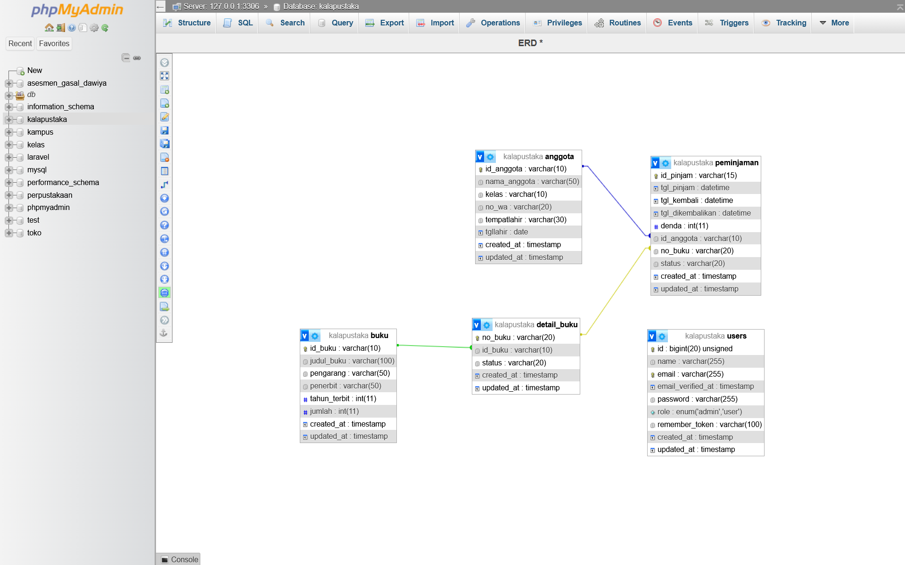

Aplikasi ini menggunakan 5 tabel utama yang saling terelasi:
- **`users`**: `id`, `name`, `email`, `password`, `role` (`admin`/`user`), `timestamps`
- **`buku`**: `id_buku` (PK), `judul_buku`, `pengarang`, `penerbit`, `tahun_terbit`, `jumlah`, `timestamps`
- **`detail_buku`**: `no_buku` (PK), `id_buku` (FK → `buku.id_buku`), `status` (`ada`/`dipinjam`), `timestamps`
- **`anggota`**: `id_anggota` (PK), `nama_anggota`, `kelas`, `no_wa`, `tempatlahir`, `tgllahir`, `timestamps`
- **`peminjaman`**: `id_pinjam` (PK), `tgl_pinjam`, `tgl_kembali`, `denda`, `id_anggota` (FK → `anggota`), `no_buku` (FK → `detail_buku`), `status` (`1`=dipinjam, `0`=selesai), `timestamps`

---

## Cara Instalasi & Menjalankan Aplikasi

1. **Clone Repository**
   ```bash
   git clone https://github.com/[username]/KalaPustaka.git
   cd KalaPustaka
   ```

2. **Instal Dependencies**
   ```bash
   composer install
   ```

3. **Konfigurasi Environment**
   Salin file `.env.example` menjadi `.env`, lalu sesuaikan konfigurasi database:
   ```env
   DB_CONNECTION=mysql
   DB_HOST=127.0.0.1
   DB_PORT=3306
   DB_DATABASE=kalapustaka
   DB_USERNAME=root
   DB_PASSWORD=
   ```

4. **Generate App Key**
   ```bash
   php artisan key:generate
   ```

5. **Jalankan Migrasi Database & Seeder**
   ```bash
   php artisan migrate --seed
   ```

6. **Jalankan Server Lokal**
   ```bash
   php artisan serve
   ```
   Buka browser di: `http://127.0.0.1:8000`

---

## Screenshot Aplikasi

### Halaman Login
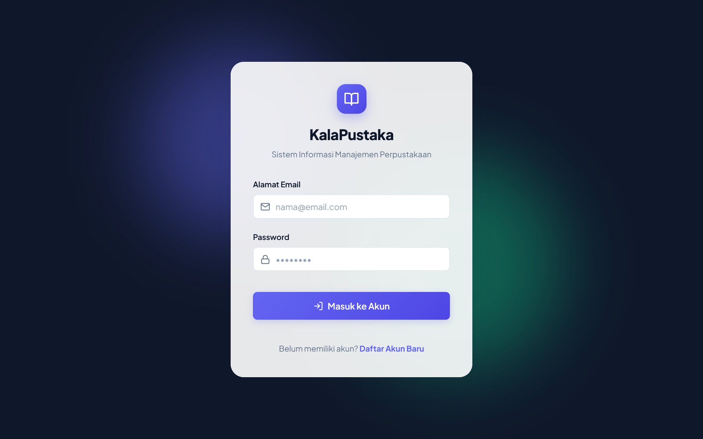

### Halaman Registrasi
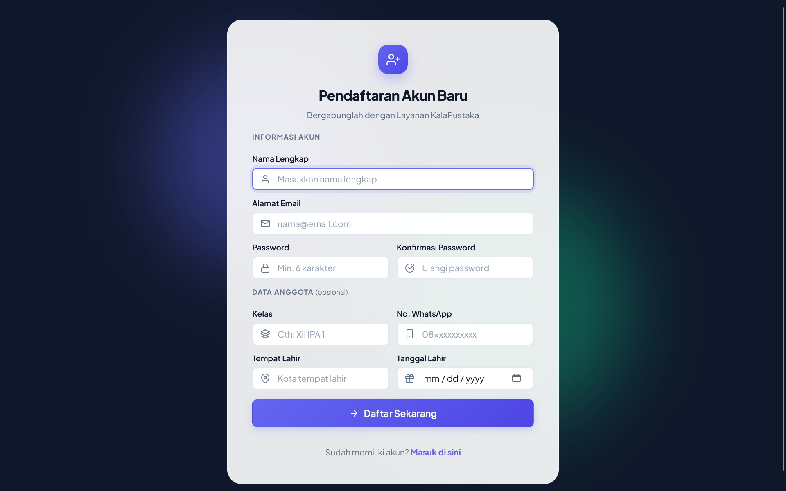

---

### Dashboard — Tampilan Admin
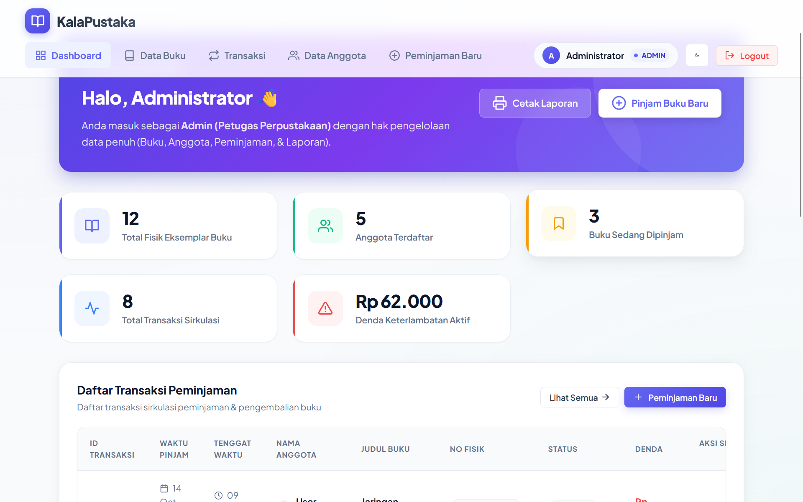

### Dashboard — Tampilan User
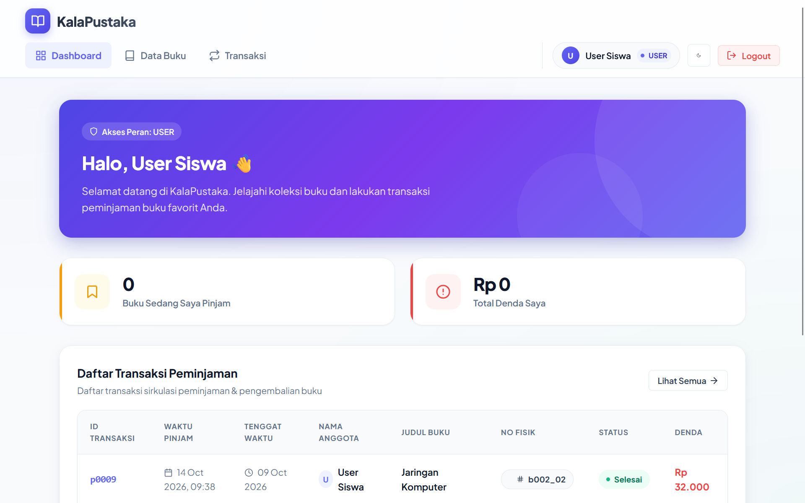

---

### Data Buku — Tampilan Admin (CRUD)
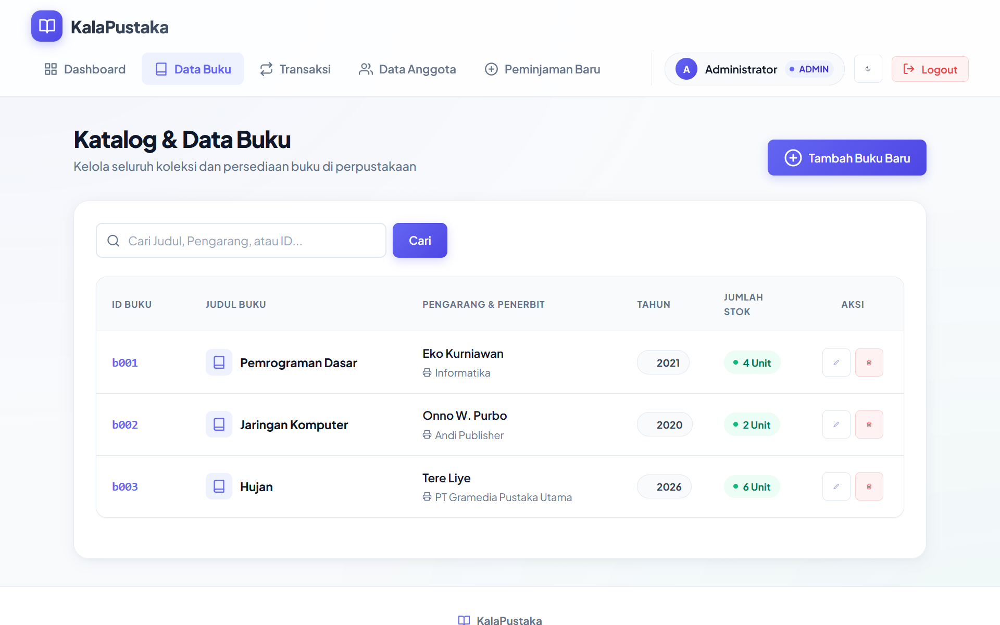

### Data Buku — Tampilan User (Hanya Lihat)
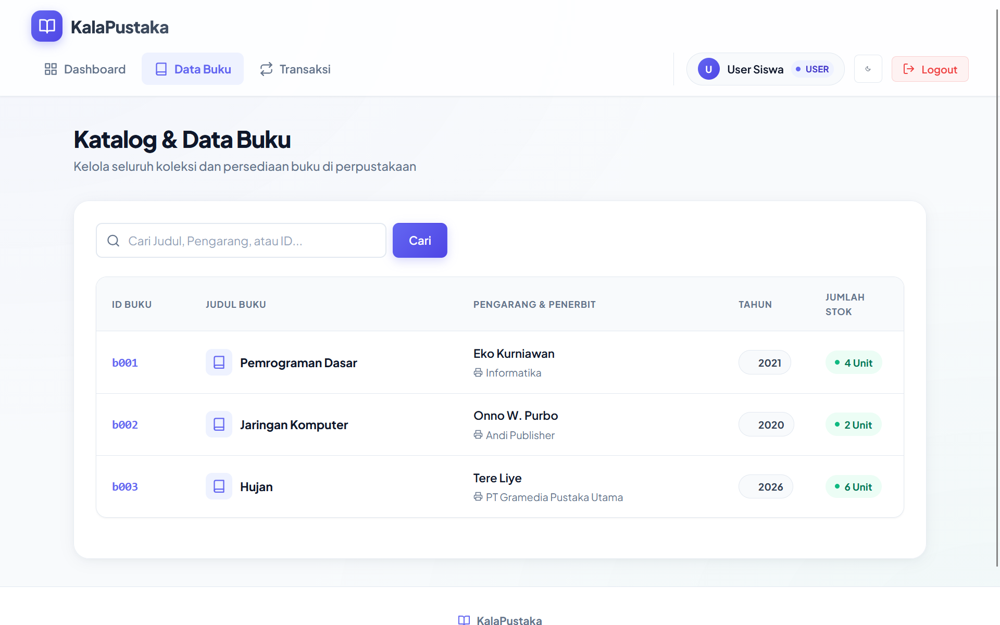

---

### Data Anggota
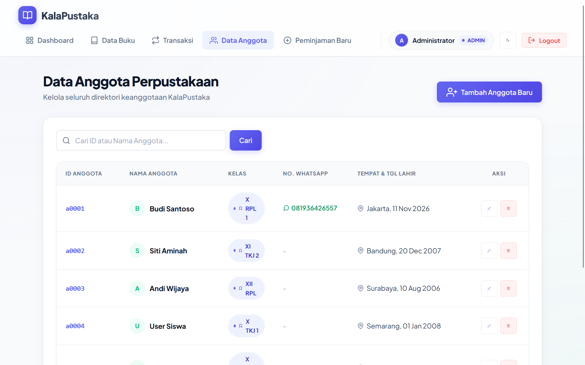

---

### Transaksi Peminjaman — Tampilan Admin
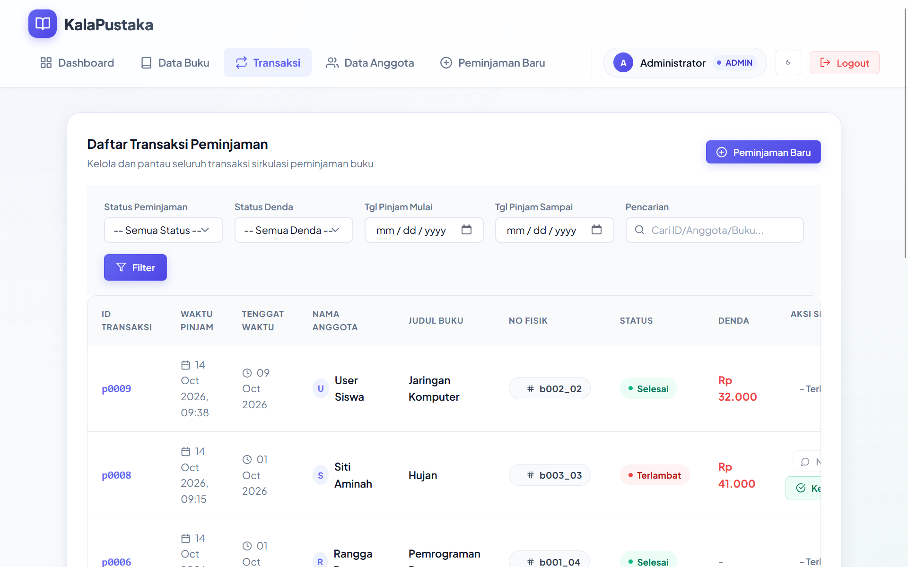

### Transaksi Peminjaman — Tampilan User
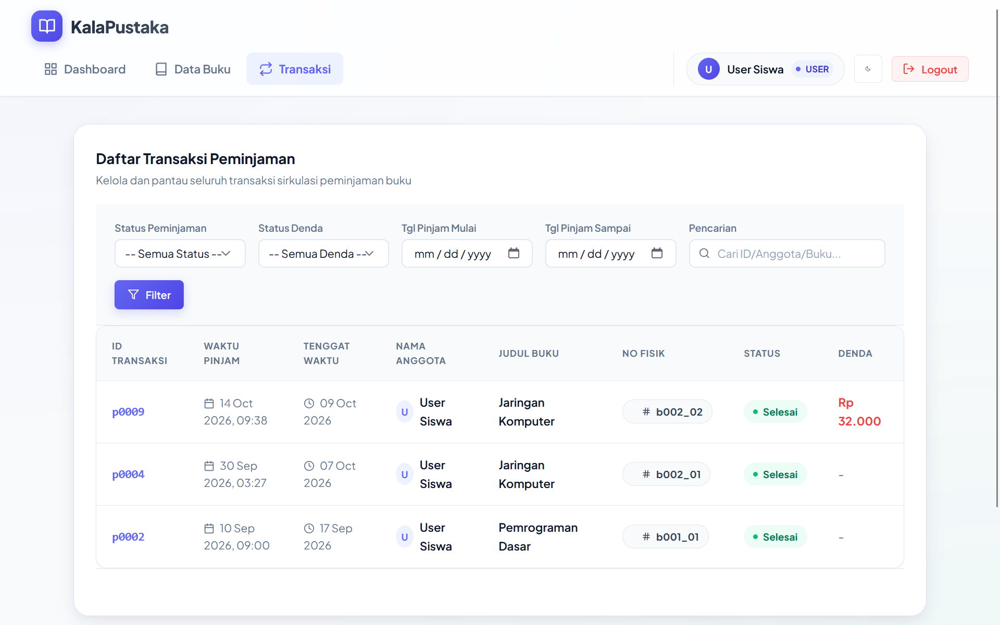

### Daftar Peminjaman
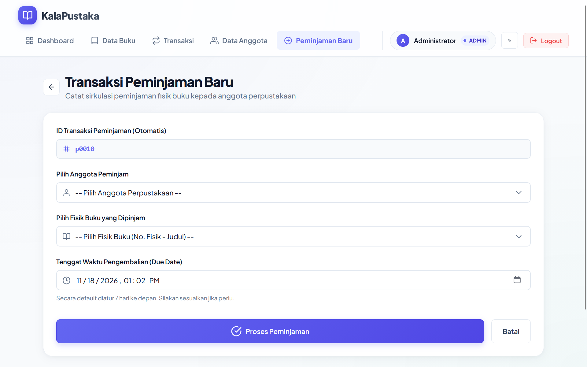

---

### Laporan PDF
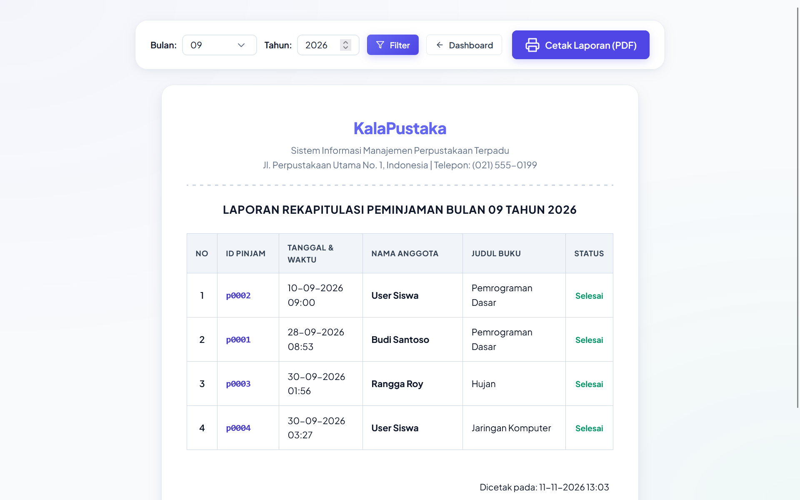

---

## Tech Stack

| Layer | Teknologi |
| :--- | :--- |
| **Backend** | PHP 8.x, Laravel 11.x |
| **Frontend** | Blade Templates, Vanilla CSS (custom design system) |
| **Database** | MySQL (via XAMPP) |
| **Icons** | Feather Icons |
| **Font** | Google Fonts - Plus Jakarta Sans |
| **Server** | Apache (XAMPP) / Laravel Artisan Serve |

---

## Lisensi
Proyek ini dibuat untuk keperluan tugas akademik Sistem Informasi Perpustakaan KalaPustaka.
